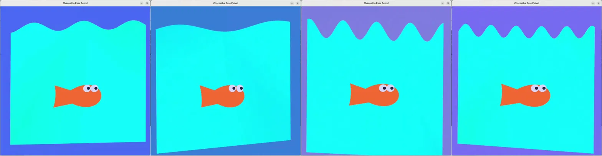
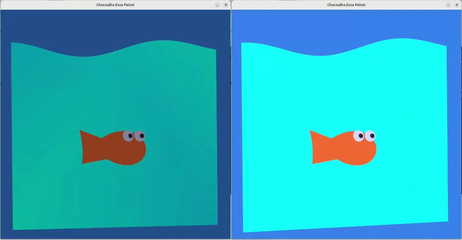
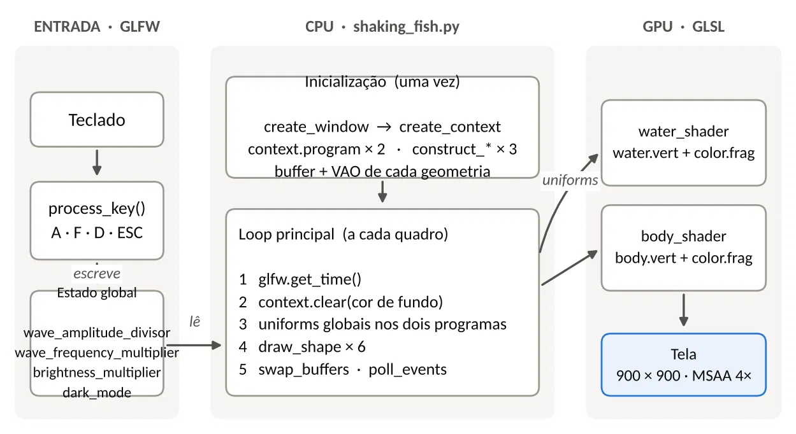
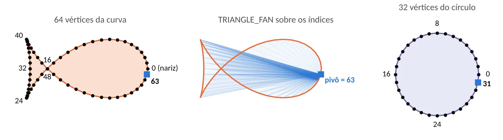
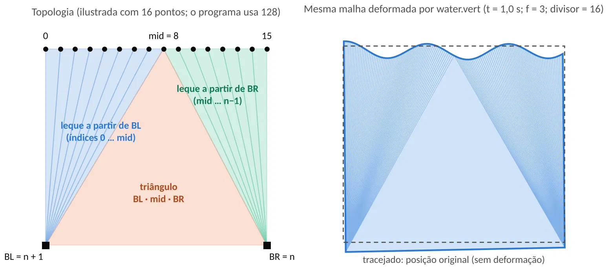

**Igor Ferreira Moraes - 11202320804**
## Chacoalha Esse Peixe
Uma cena com um peixe laranja em um pedaço de água que pode balançar de acordar com as entradas que damos.

**Controles de Frequência e Amplitude**: Mudam a altura e o espaçamento das ondas na superfície, deixando elas calmas ou agitadas dinamicamente via teclado. Também afeta as cores do fundo.


**Modo Dia e Noite**: Muda o multiplicador das cores, deixando claro ou escuro.

## Arquitetura e Código
A cena funciona com duas partes, o código em Python na CPU (gerenciamento de eventos, lógica de estado e envio de dados) e GLSL na GPU (processamento de vértices, deformação e rasterização de pixels).
**Entrada**: O GLFW captura eventos nas teclas `A`, `F`, `D` e `ESC` que são processados na função `process_key()`. Esses eventos alteram o estado global da aplicação, modificando parâmetros como a amplitude da onda (`wave_amplitude_divisor`), frequência (`wave_frequency_multiplier`), brilho (`brightness_multiplier`) e dia/noite (`dark_mode`).
**Ptyhon**:
- Inicialização: A janela é criada com o GLFW (`create_window`) e o contexto gráfico com ModernGL (`create_context`). Os dois programas de shader são compilados (`water_shader` e `body_shader`). As geometrias são construídas gerando os VAOs e VBOs.
- Loop Principal (por quadro): 
	1. Pega o tempo atual com `glfw.get_time()`.
	2. Limpa o framebuffer `context.clear()` com a cor de fundo, definida em função da frequência e amplitude.
	3. Atualiza as variáveis uniform globais (tempo, amplitude, frequência, brilho) nos dois shaders.
	4. Desenha cada elemento da cena (água, corpo do peixe, olhos) com `draw_shape()`.
	5. Faz a troca de buffers (`swap_buffers`) e processa eventos pendentes (`poll_events`)
**GLSL**: O programa `water_shader` Combina os arquivos `water.vert` e `color.frag` para renderizar a água. Já o `body_shader` Combina `body.vert` e `color.frag` para renderizar o peixe e os olhos. 
## Geometrias
**Peixe**: O corpo do peixe é feito com uma curva paramétrica que achei no [Wolfram Alpha](https://mathworld.wolfram.com/FishCurve.html), dividida em 64 vértices. Usa o `TRIANGLE_FAN`, um pivô é conectado a todos os outros vértices para preencher a forma. Já os olhos feitos reutilizando a mesma forma com parâmetros para formar uma curva.

**Água**: Basicamente uma linha de 128 pontos na parte de cima e dois vértices embaixo. É construída  `TRIANGLES`, metade dos triângulos tem um pivô em um canto e a outra metade é no outro canto. A parte de cima tem a posição $Y$ de cada ponto deformada no shader `water.vert` por funções trigonométricas baseadas no tempo.
## Shaders
**Água**
O shader de vértices aplica um deslocamento:
``` c
float y = vPosition.y + (sin(-u_time * u_wave_frequency_multiplier + (vPosition.x + vPosition.y) *  3.14 * u_wave_frequency_multiplier) / u_wave_amplitude_divisor) + cos(u_time * u_wave_frequency_multiplier + vPosition.x)/20;

float x = vPosition.x + cos(u_time * u_wave_frequency_multiplier/2 + (vPosition.x + vPosition.y) / 4) / 24;
```
E faz uma transformação nas cores:
```c
v2fcolor = vec4(u_color.r, u_color.g + sin(vPosition.x * vPosition.y + u_time) / 8, u_color.b+ cos(vPosition.x * vPosition.y + u_time) / 8, u_color.a);
```
**Peixe**
Controla as transformações do peixe, que é um deslocamento menos intenso:
``` c
float x = vPosition.x + cos(u_time * u_wave_frequency_multiplier/2 + (vPosition.x + vPosition.y) / 2) / 6;
	
float y = vPosition.y + sin(u_time * u_wave_frequency_multiplier + vPosition.x)/u_wave_amplitude_divisor/2;
```
**Cores**
O shader de fragmentos parte da cor base e aplica o fator de atenuação de brilho definida pelo modo Dia/Noite. É o mesmo para o peixe e a água.
